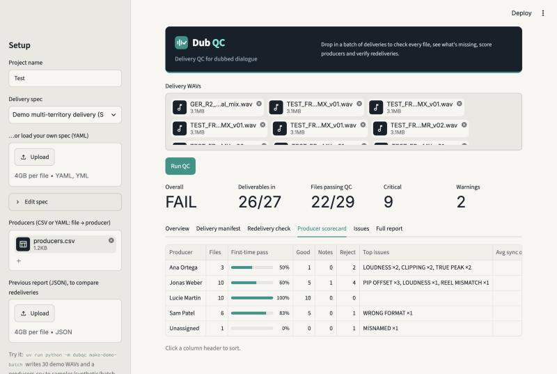

# Dub QC

**Delivery QC for dubbed dialogue.** · [**See the project page →**](https://lmmorrod.github.io/dub-qc/)

Dub QC checks dubbed audio deliveries automatically and flags errors with timecodes. It's designed to run alongside a manual listen-through, with a QC checklist and a delivery-tracking spreadsheet. It runs the technical checks at every stage, from raw dialogue to final deliverables, keeps track of what's still outstanding across territories, versions and redeliveries, and points whoever is doing the listen-through to exactly where to listen.


## The problem

A dubbed version of a film is checked several times before it's delivered. Each territory sends in its recorded dialogue, which is prepared and mixed. The mix is then checked, fixed and checked again as it moves from premix to printmaster to a final QC. Finally it's turned into every version the release needs (theatrical, nearfield, IMAX, Atmos, broadcast R128, streaming), reeled or continuous, each with its own spec and timecode layout.

The music and effects stems need checking too: for technical faults, and for any voice content (walla, breaths, efforts) that the dialogue editors need to know about.

That's a lot of passes, files and formats, and every QC pass depends on someone listening for everything and knowing what to look for. Dub QC runs the technical checks automatically at every stage, points the QCer to exactly where to listen, and keeps the notes that matter attached to the right timecodes from one pass to the next.

## What it does

### Technical checks on every file

| Check | What it looks for | Why it matters |
|---|---|---|
| **Naming** | `<TITLE>_<TERR>_<REEL>_<STEM>_<STAGE>[_<VERSION>]_v<NN>.wav`, e.g. `TEST_SPC_R1_DX_PMX_v01.wav` or `TEST_SPC_CONT_DX_PMR_R128_v01.wav`. Says which part is wrong. | Misnamed files get loaded into the wrong reel, territory or version. |
| **Format** | Sample rate, bit depth and channels against the spec (default 48 kHz / 24-bit / mono). | A wrong format means a redelivery; a wrong sample rate drifts sync. |
| **Loudness and true peak** | Integrated LUFS and true peak (4× oversampled) against the limits for that file's delivery version. | Out-of-spec loudness is rejected downstream. |
| **Clipping** | Runs of full-scale samples, with timecodes. | Clipping is baked in: the line has to be re-exported or re-recorded. |
| **Sync pip** | The 1-frame pip 2 s before first frame of action, with the offset in frames. Per-reel and continuous timecode layouts. | A track that's out from the pip onwards is the classic delivery error. |
| **Pre-FFOA audio and noise floor** | Stray audio before picture starts, and noisy dialogue recordings. | Usually a slipped line or a poor recording environment. |

Every file gets a rating (Good / Acceptable with notes / Reject) and a short load report to send back to the territory.

### Built around the workflow

- **Delivery versions.** One spec holds a profile per version (theatrical, nearfield, broadcast R128 and so on), each with its own loudness, peak and format limits. Each file is checked against the version in its name, so the same mix can pass as theatrical and fail as R128.
- **Stage-aware QC.** Raw dialogue, premix (PMX), printmaster (PMR) and final QC (FSS) each run the checks that make sense at that stage (raw dialogue isn't loudness-checked, for example). Dialogue and music and effects stems get different checks too.
- **"What to listen for."** Each report lists the listening checks for that pass, by stage and stem (e.g. *"Every line present, including off-screen and background lines"*), alongside what Dub QC has already checked automatically.
- **Voice markers in music and effects.** Music and effects stems get the technical checks plus a voice detector that flags likely walla, breaths, efforts or stray dialogue as timecoded markers, so dialogue editors don't double them with the dub. It picks up the syllable-rate rhythm of speech, which music and effects rarely have.
- **Editor notes.** Timecoded notes in a simple CSV (*"off-screen line: guard calls out from behind the door"*). They carry into every later pass: each note is checked in every file it applies to, and flagged if the noted line has gone quiet.

### Across a whole delivery

- **Delivery manifest.** The spec lists what should arrive (territories × reels × stems × versions). Dub QC reports **Missing**, **Duplicate** (no clear latest version) and **Unexpected** files, one line per territory: *"SPC: 8/9 delivered, R3 DX missing"*.
- **Redelivery check.** When v02 arrives it's re-checked and compared with v01. Every earlier issue is marked **Fixed** or **Still present**, and anything else is flagged as a **New issue**, all with timecodes.
- **Producer scorecard.** Map files to the producer who made them (a simple CSV) to see files delivered, first-time pass rate, Good/Notes/Reject counts, top issue types, average sync offset, and a one-line summary such as *"3 of 5 rejects are sync pip, so sync training needed."*

### Outputs

- **HTML report:** summary, listening checklist, manifest grid, redelivery check, editor notes, sortable scorecard, issue table with suggested fixes, and waveforms with issue markers.
- **JSON:** machine-readable, and usable as the baseline for the next redelivery check.
- **Marker list:** tab-separated timecode / name / comment, covering QC issues, voice markers and editor notes, for dropping into an editing session.

<details>
<summary>Full report</summary>


</details>

## Run it

Needs [uv](https://docs.astral.sh/uv/), which installs Python and the libraries for you.

```bash
uv sync
```

**Web app:**

```bash
uv run streamlit run app.py
```



**Command line:**

```bash
uv run python -m dubqc check deliveries/*.wav --spec samples/demo_batch/spec.yaml --producers producers.csv --notes editor_notes.csv
```

Add `--baseline reports/<earlier>_report.json` to compare redeliveries against an earlier run. Reports are written to `reports/`.

**Try it with demo data.** This generates a synthetic 30-file batch (3 territories × 3 reels × DX/MX/FX, four made-up producers, editor notes and planted problems):

```bash
uv run python -m dubqc make-demo-batch
```
```bash
uv run python -m dubqc check samples/synthetic/batch/*.wav --spec samples/demo_batch/spec.yaml --producers samples/synthetic/batch/producers.csv --notes samples/synthetic/batch/editor_notes.csv --project Test
```

**Tests:**

```bash
uv run pytest
```

## Configuration

Everything lives in the spec YAML: loudness and peak limits, delivery versions, format, naming pattern, reel and continuous timecodes, pip tolerance, which checks run at each stage and on each stem, the listening checklists, the expected deliverables, and the detector and notes thresholds. See [samples/demo_batch/spec.yaml](samples/demo_batch/spec.yaml) (multi-territory) and [samples/single_reel/spec.yaml](samples/single_reel/spec.yaml) (single reel). Sample [producers](samples/demo_batch/producers.csv) and [editor notes](samples/demo_batch/editor_notes.csv) files are alongside.

## Next up

- **Script check.** Load the script, transcribe the audio, and confirm every scripted line is accounted for, including off-screen lines, flagging unscripted or changed lines too
- Line-by-line sync drift against the original version
- Auto-drafted pickup requests for missing lines
- Turnaround tracking: due dates per deliverable, and late deliveries on the scorecard
- Lip-sync scoring, room-tone matching, multi-speaker diarisation

## About the demo data

All audio, titles, territories, producer names and notes in this repo are synthetic or made up. The demo dialogue is shaped noise, the music is a chord bed and the effects are ambience with impacts, all with a real 1-frame sync pip. They're generated by [dubqc/demo.py](dubqc/demo.py).

Built with Python, numpy, scipy, soundfile, pyloudnorm and Streamlit.
