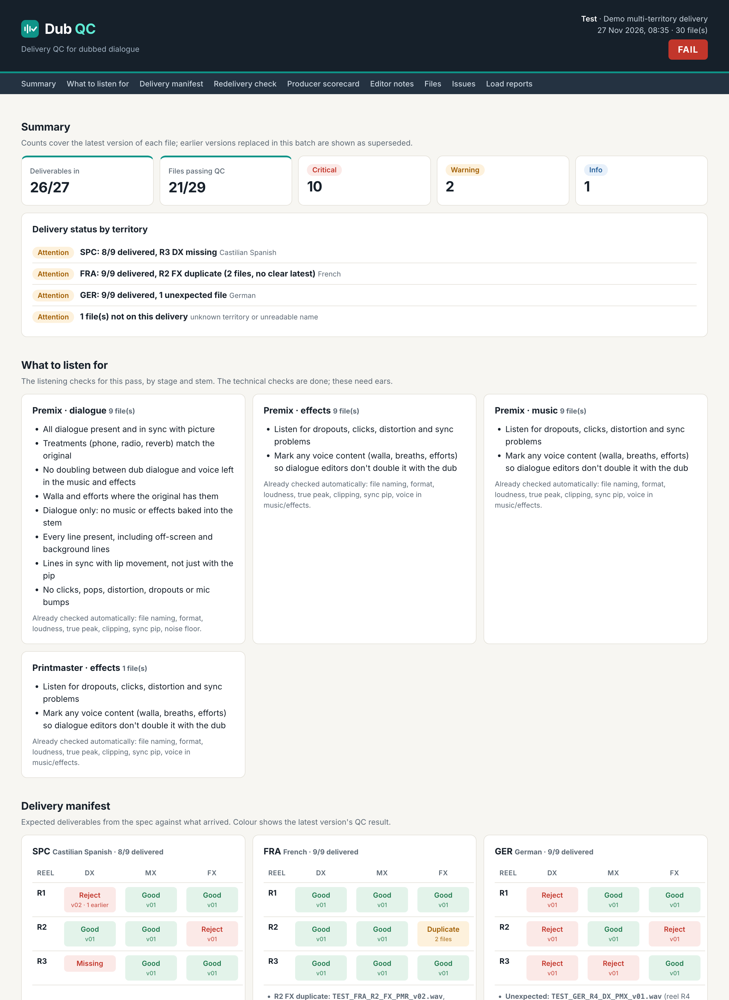
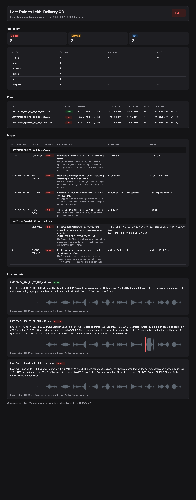

# Dub QC

**Delivery QC for dubbed dialogue.**

Dub QC checks dubbed audio deliveries automatically and tells you, with timecodes, what's wrong, what's missing and who needs support. It replaces a manual listen-through, a QC checklist and a delivery-tracking spreadsheet.



## The problem

A dubbed release arrives as dozens of files. Each territory sends dialogue, music and effects stems for every reel, often through different freelance producers, and often in several versions. QC by hand is slow and things slip through:

- **Files that won't load or play correctly:** wrong sample rate, wrong bit depth, misnamed files.
- **Technical faults that bounce a delivery:** loudness out of spec, true peak over the ceiling, clipped lines.
- **Sync errors:** a track that's a few frames out from the sync pip onwards.
- **Delivery gaps nobody notices until the deadline:** a missing reel, two "final" versions of the same stem, files that aren't on the delivery at all.
- **Redeliveries that aren't checked properly:** v02 arrives, but did it fix v01's problems, or add new ones?
- **No view across producers:** who delivers clean first time, and who keeps failing on the same thing.

Dub QC runs every check on every file and rolls the results up into a batch view that an operations team can act on.

## What it does

### Per-file checks

| Check | What it looks for | Why it matters |
|---|---|---|
| **Naming** | `<TITLE>_<TERR>_<REEL>_<STEM>_<STAGE>_v<NN>.wav`, e.g. `TEST_SPC_R1_DX_PMX_v01.wav`. Says which part is wrong. | Misnamed files get loaded into the wrong reel or territory. |
| **Format** | Sample rate, bit depth and channels against the spec (default 48 kHz / 24-bit / mono). | A wrong format means a redelivery; a wrong sample rate drifts sync. |
| **Loudness** | Integrated LUFS (EBU R128 by default, −23 ±1) and true peak (≤ −1 dBTP, 4× oversampled). | Out-of-spec loudness is rejected downstream. |
| **Clipping** | Runs of full-scale samples, with timecodes. | Clipping is baked in: the line has to be re-exported or re-recorded. |
| **Sync pip** | The 1-frame 1 kHz pip 2 s before first frame of action, with the offset in frames. Each reel can have its own timecodes. | A track that's out from the pip onwards is the classic delivery error. |
| **Pre-FFOA audio and noise floor** | Stray audio before picture starts, and noisy recordings. | Usually a slipped line or a poor recording environment. |

Every file gets a rating (Good / Acceptable with notes / Reject) and a short load report to send back to the territory.

### Batch checks

- **Delivery manifest.** The spec lists what should arrive (territories × reels × stems). Dub QC compares that with what did arrive and reports **Missing**, **Duplicate** (two versions of the same deliverable with no clear latest) and **Unexpected** files, one line per territory: *"SPC: 8/9 delivered, R3 DX missing"*.
- **Redelivery check.** When v02 arrives, it's re-checked and compared with v01. Every earlier issue is marked **Fixed** or **Still present**, and anything else is flagged as a **New issue**, all with timecodes. The earlier version can be in the same batch, or come from a previous run's JSON report.
- **Producer scorecard.** Tag each file with the producer who made it (a simple CSV). For each producer you get files delivered, first-time pass rate, Good/Notes/Reject counts, top issue types, average sync offset, and a one-line summary such as *"Strong on clipping and noise; 3 of 4 rejects are sync pip, so sync training needed."*

### Outputs

- **HTML report:** summary, manifest grid, redelivery check, sortable scorecard, issue table with suggested fixes, and waveforms with issue markers.
- **JSON:** machine-readable, and usable as the baseline for the next redelivery check.
- **Marker list:** tab-separated timecode / name / comment, for dropping QC notes into an editing session.

<details>
<summary>Full report</summary>



</details>

## Run it

Needs [uv](https://docs.astral.sh/uv/), which installs Python and the libraries for you.

```bash
uv sync
```

**Web app:**

```bash
uv run streamlit run app.py
```


**Command line:**

```bash
uv run python -m dubqc check deliveries/*.wav --spec samples/demo_batch/spec.yaml --producers samples/demo_batch/producers.csv
```

Add `--baseline reports/<earlier>_report.json` to compare redeliveries against an earlier run. Reports are written to `reports/`.

**Try it with demo data.** This generates a synthetic 30-file batch (3 territories × 3 reels × DX/MX/FX, four made-up producers, with planted problems):

```bash
uv run python -m dubqc make-demo-batch
```
```bash
uv run python -m dubqc check samples/synthetic/batch/*.wav --spec samples/demo_batch/spec.yaml --producers samples/synthetic/batch/producers.csv --project Test
```

**Tests:**

```bash
uv run pytest
```

## Configuration

Everything lives in the spec YAML: loudness and peak limits, format, naming pattern, per-reel timecodes, pip tolerance, the expected deliverables, and the redelivery matching tolerance. See [samples/demo_batch/spec.yaml](samples/demo_batch/spec.yaml) (multi-territory) and [samples/single_reel/spec.yaml](samples/single_reel/spec.yaml) (single reel).

## Next up

- Speech-to-text script check: missing, extra and changed lines against the dub script
- Line-by-line sync drift against the original version
- Auto-drafted pickup requests for missing lines
- Turnaround tracking: due dates per deliverable, and late deliveries on the scorecard
- Lip-sync scoring, room-tone matching, multi-speaker diarisation

## About the demo data

All audio, titles, territories and producer names in this repo are synthetic or made up. The demo "dialogue" is shaped noise with a real 1-frame sync pip, generated by [dubqc/demo.py](dubqc/demo.py).

Built with Python, numpy, scipy, soundfile, pyloudnorm and Streamlit.
